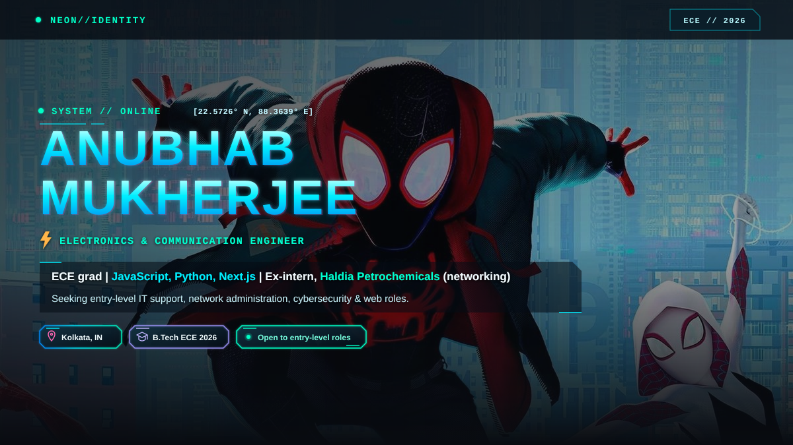
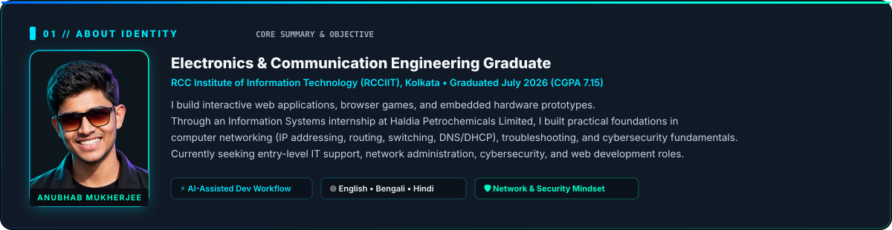
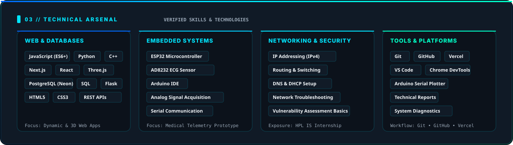
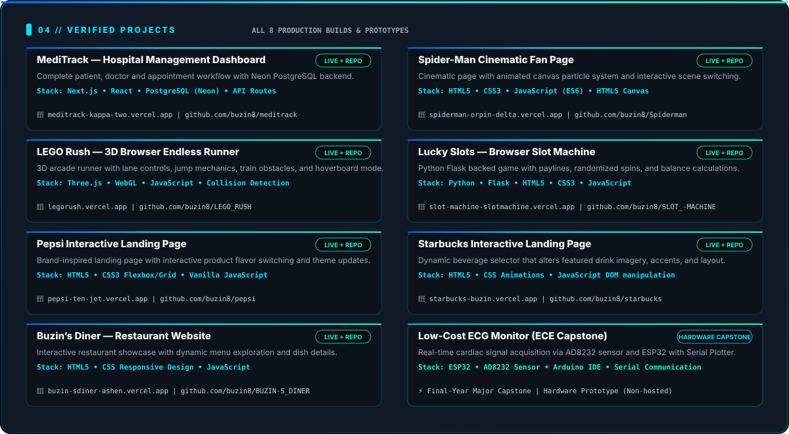
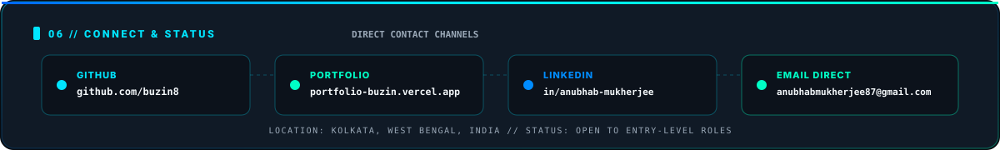

<div align="center">
  
</div>

---

### `[ 01 // IDENTITY ] — About Me`

<p align="center">
  
</p>

<table>
  <tr>
    <td width="65%" valign="top">
      <h4>⚡ B.Tech in Electronics and Communication Engineering</h4>
      <p><b>RCC Institute of Information Technology (RCCIIT), Kolkata</b> • Graduated <b>July 2026</b> • CGPA <b>7.15</b></p>
      <p>I build practical web experiences, interactive 3D browser games, and embedded telemetry prototypes. Through an Information Systems internship at <b>Haldia Petrochemicals Limited</b>, I gained foundational knowledge in computer networking, IP addressing, routing, switching, DNS/DHCP, and basic troubleshooting.</p>
      <p>I embrace an <b>honest engineering philosophy</b>: I describe my capabilities truthfully, whether it's building full-stack dashboards with Next.js and PostgreSQL, crafting hardware capstones with ESP32 and AD8232 ECG sensors, or leveraging AI-assisted workflows to deliver clean, production-ready code.</p>
    </td>
    <td width="35%" valign="top">
      <h4>📍 Quick Facts</h4>
      <p>• <b>Location:</b> Kolkata, West Bengal, India [ 22.5726° N, 88.3639° E ]</p>
      <p>• <b>Target Roles:</b> IT Support, Network Admin, Security, Web Dev</p>
      <p>• <b>Languages:</b> English, Bengali, Hindi</p>
      <p>• <b>Methodology:</b> AI-Assisted Workflow · Clean Code</p>
      <p>• <b>Status:</b> Open to entry-level roles</p>
      <p>• <b>Live Portfolio:</b> <a href="https://portfolio-buzin.vercel.app">portfolio-buzin.vercel.app</a></p>
    </td>
  </tr>
</table>

---

### `[ 02 // FIELD WORK ] — Work Experience`

```text
┌──────────────────────────────────────────────────────────────────────────────┐
│ INFORMATION SYSTEMS INTERN — HALDIA PETROCHEMICALS LIMITED, KOLKATA         │
│ Duration: July 2025 – August 2025                                           │
└──────────────────────────────────────────────────────────────────────────────┘
```

- **Networking Fundamentals:** Studied computer networking concepts including IPv4 addressing, routing, switching, DNS, and DHCP configuration within enterprise infrastructure.
- **Network Troubleshooting & IT Support:** Assisted with basic network troubleshooting and IT support activities, diagnosing connectivity issues and documenting user-facing support tickets.
- **Cybersecurity Exposure:** Gained practical exposure to cybersecurity concepts, baseline vulnerability assessment practices, and security procedures.
- **Documentation & Reporting:** Prepared technical reports and collaborated with team members to resolve day-to-day network requirements.

---

### `[ 03 // ARSENAL ] — Technical Skills`

<p align="center">
  
</p>

<table align="center" width="100%">
  <tr>
    <th align="left" width="25%">🌐 Web & Databases</th>
    <th align="left" width="25%">⚡ Embedded Systems</th>
    <th align="left" width="25%">🛡️ Networking & Security</th>
    <th align="left" width="25%">🛠️ Tools & Platforms</th>
  </tr>
  <tr>
    <td valign="top">
      • JavaScript (ES6+)<br/>
      • Python<br/>
      • C++<br/>
      • Next.js<br/>
      • React<br/>
      • Flask<br/>
      • Three.js (WebGL)<br/>
      • PostgreSQL (Neon)<br/>
      • SQL<br/>
      • HTML5 & CSS3<br/>
      • REST APIs
    </td>
    <td valign="top">
      • ESP32 Microcontroller<br/>
      • AD8232 ECG Sensor<br/>
      • Arduino IDE<br/>
      • Analog Signal Acquisition<br/>
      • Serial Communication<br/>
      • Hardware Prototyping
    </td>
    <td valign="top">
      • IP Addressing (IPv4)<br/>
      • Routing & Switching<br/>
      • DNS & DHCP<br/>
      • Network Troubleshooting<br/>
      • Vulnerability Assessment Basics<br/>
      • System Diagnostics
    </td>
    <td valign="top">
      • Git<br/>
      • GitHub<br/>
      • Vercel Deployment<br/>
      • VS Code<br/>
      • Chrome DevTools<br/>
      • REST APIs
    </td>
  </tr>
</table>

---

### `[ 04 // VERIFIED BUILDS ] — Projects Showcase`

<p align="center">
  
</p>

| # | Project | Description | Tech Stack | Links |
|---|---|---|---|---|
| **01** | **MediTrack — Hospital Management Dashboard** | Full-stack hospital management dashboard managing patient records, doctor scheduling, and appointments with live Neon PostgreSQL persistence. | `Next.js` `React` `PostgreSQL` | [Live](https://meditrack-kappa-two.vercel.app) · [GitHub](https://github.com/buzin8/meditrack) |
| **02** | **Spider-Man Cinematic Fan Page** | Responsive cinematic web experience featuring interactive animated canvas particles and dynamic scene switches between Homecoming and Brand New Day. | `HTML5` `CSS3` `JavaScript` | [Live](https://spiderman-orpin-delta.vercel.app/) · [GitHub](https://github.com/buzin8/Spiderman) |
| **03** | **LEGO Rush — 3D Endless Runner** | Full 3D browser runner with lane controls, jump mechanics, dynamic train obstacles, coin collection, and hoverboard mode in a stylized Tokyo setting. | `Three.js` `JavaScript` `WebGL` | [Live](https://legorush.vercel.app) · [GitHub](https://github.com/buzin8/LEGO_RUSH) |
| **04** | **LuckySlots — Browser Slot Machine** | Python Flask-backed slot game featuring adjustable bets and paylines, balance tracking, randomized spins, and winning-line evaluation. | `Python` `Flask` `JavaScript` | [Live](https://slot-machine-slotmachine.vercel.app) · [GitHub](https://github.com/buzin8/SLOT_MACHINE) |
| **05** | **Pepsi Interactive Landing Page** | Responsive brand-inspired landing page with interactive product flavor selection that seamlessly transitions hero imagery and color themes. | `HTML5` `CSS3` `JavaScript` | [Live](https://pepsi-ten-jet.vercel.app/) · [GitHub](https://github.com/buzin8/pepsi) |
| **06** | **Starbucks Interactive Landing Page** | Interactive beverage showcase featuring dynamic beverage selection, CSS layout transforms, and responsive typography. | `HTML5` `CSS3` `JavaScript` | [Live](https://starbucks-buzin.vercel.app/) · [GitHub](https://github.com/buzin8/starbucks) |
| **07** | **Buzin’s Diner — Restaurant Website** | Welcoming restaurant website where users explore categorized culinary offerings, dish details, and ordering highlights. | `HTML5` `CSS3` `JavaScript` | [Live](https://buzin-diner-ashen.vercel.app/) · [GitHub](https://github.com/buzin8/BUZIN_S_DINER) |
| **08** | **Low-Cost ECG Monitoring System** | Final-year ECE capstone prototype interfacing an AD8232 ECG sensor with an ESP32 microcontroller for real-time analog signal acquisition and live serial telemetry. | `ESP32` `AD8232` `Arduino IDE` | Hardware prototype |

---

### `[ 05 // TELEMETRY ] — GitHub Activity & Languages`

<div align="center">
  <table border="0" cellspacing="0" cellpadding="0">
    <tr align="center">
      <td>
        
      </td>
      <td>
        
      </td>
    </tr>
    <tr align="center">
      <td colspan="2">
        <br/>
        
      </td>
    </tr>
  </table>
</div>

---

### `[ 06 // DIRECT NODES ] — Connect & Opportunities`

<p align="center">
  
</p>

<p align="center">
  <i>Available for entry-level IT support, network administration, cybersecurity, and web development roles. Feel free to reach out directly via email or view my verified repositories and deployed projects.</i>
</p>

<p align="center">
  <a href="mailto:anubhabmukherjee87@gmail.com">
    
  </a>
  <a href="https://portfolio-buzin.vercel.app">
    
  </a>
  <a href="https://www.linkedin.com/in/anubhab-mukherjee-022771372/">
    
  </a>
  <a href="https://github.com/buzin8">
    
  </a>
</p>

<p align="center">
  <sub>⚡ NEON//IDENTITY • Anubhab Mukherjee • Obsidian Black × Cyan × Spider-Verse • Kolkata, West Bengal, India</sub>
</p>
